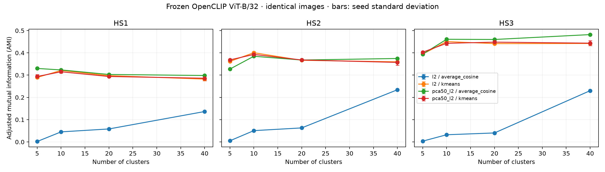

# First results: Clustering meets Vision and Language

LMU Topic 1 · executed 29 October 2026 · report generated 2026-10-29T01:10:47.134489+00:00.

The real Europeana/MIMO pipeline completed: **2,000 unique validated pilot images**, frozen OpenCLIP embeddings, and **32 clustering runs**. All 96 metric rows were independently recomputed from saved predictions. No other dataset was substituted. Historical numbers in `EXPLAINER.md` were not reused as observations.

## Acquisition and dataset

Europeana verification returned 63,478 MIMO image records. Harvested 63,478 unique metadata records across 636 cursor pages; complete snapshot: True. Metadata includes stable record IDs, all HS concept URIs, resolved codes, source titles/instrument names, museums, provider, image URLs, origin/place strings, provider country, dates, creators and rights where supplied.

Pilot: 2,000 images from **216 museums**, 5 represented HS1 classes, 11 HS2 classes and 22 HS3 classes. Metadata snapshot includes 216 museums. Sampling uses seed 42, a deterministic museum round-robin, and stable hashed ordering within museums. Missing labels are retained; every clustering sees the same 2,000 rows.

| Outcome | Actual count |
| --- | --- |
| Selected unique valid images | 2000 |
| Candidate records processed | 2032 |
| ok | 2000 |
| duplicate | 22 |
| download_failed | 1 |
| prefetched_unused | 9 |
| Distinct image files stored, including smoke and unused candidates | 2062 |
| Exact duplicate pixels in selected pilot | 0 |

Individual URL failures before fallback: 2. Candidate outcomes and every failed URL are preserved in `data/mimo_pilot/download_ledger_pilot.csv`. Successful decoding does not establish that a photo depicts a complete instrument. Stored files can exceed 2,000 because smoke images, duplicate candidates and unused prefetches are retained. All photo bytes, including gallery thumbnails, remain inside ignored `data/`.

The one failed candidate, `/09102/_NYC_IUE076` (The Nydahl Collection), returned a decodable 400×23 preview, rejected because its shortest side is below the declared 32-pixel threshold. Its source-image fallback encountered an SSL error. It was replaced by the next valid candidate; this was a size-policy rejection rather than a corrupt JPEG. [Measured diagnosis](results/pilot/download_failure_diagnosis.json).

### Missing fields

| Field | Missing in pilot | Missing in full metadata |
| --- | --- | --- |
| hs1 | 435 | 22337 |
| hs2 | 437 | 22371 |
| hs3 | 451 | 22654 |
| origin | 811 | 24554 |
| rights | 0 | 0 |
| instrument_names | 0 | 0 |

Missing HS labels include absent concepts, unresolved codes, codes too short for a level, and conflicts between multiple source concepts. Evaluation excludes only the missing label for the level being scored; embedding, PCA and clustering still use every image. The label mask is identical across all methods.

### HS1 distribution

| HS1 code | Family | Pilot images |
| --- | --- | --- |
| 4 | Aerophones | 815 |
| (missing) | Missing/ambiguous | 435 |
| 3 | Chordophones | 405 |
| 1 | Idiophones | 254 |
| 2 | Membranophones | 76 |
| 5 | Electrophones | 15 |

### Most common HS3 labels

| HS3 | Pilot images |
| --- | --- |
| (missing) | 451 |
| 423 | 286 |
| 421 | 279 |
| 321 | 211 |
| 422 | 184 |
| 111 | 132 |
| 314 | 130 |
| 211 | 72 |
| 112 | 69 |
| 412 | 65 |
| 322 | 35 |
| 122 | 28 |
| 312 | 15 |
| 121 | 14 |
| 531 | 7 |
| 513 | 5 |
| 242 | 4 |
| 311 | 4 |
| 313 | 3 |
| 533 | 3 |

Full class distributions: [HS1](results/pilot/hs1_distribution.csv), [HS2](results/pilot/hs2_distribution.csv), [HS3](results/pilot/hs3_distribution.csv). No class-frequency cutoff was applied.

### Museum coverage

| Museum (15 largest pilot contributions) | Images |
| --- | --- |
| Accademia Gallery in Florence - Department of Musical Instruments | 14 |
| American Museum & Gardens | 14 |
| Angoulême Museum | 14 |
| Arlaten Museum | 14 |
| Ashmolean Museum | 14 |
| Auguste Grasset Museum | 14 |
| Barcelona Music Museum | 13 |
| Barrois Museum | 13 |
| Basque Museum in Bayonne | 13 |
| Bristol Museums, Galleries & Archives | 13 |
| Calvet Museum | 13 |
| Castle Museum of Gien | 13 |
| Castre Museum | 13 |
| Cliffe Castle Museum | 13 |
| Cobbe Collection | 13 |

All represented museums and counts: [museum distribution](results/pilot/museum_distribution.csv). The museum-balanced sampling policy overrepresents small collections and is not representative of the overall MIMO collection.

### Names, origin, rights and image size

| Common source title / instrument name | Images |
| --- | --- |
| Bugle | 41 |
| Drum | 27 |
| Flute | 22 |
| Cloche | 20 |
| Violin | 18 |
| Clochette | 16 |
| Rattle | 16 |
| Bell | 14 |
| Grand pianoforte | 14 |
| Piano carré | 14 |

1189 pilot records contain origin/place strings. These are retained verbatim and may include manufacture, use or enriched geographic context; provider country is kept separately. Titles are multilingual source descriptions rather than standardized instrument categories.

| Rights statement | Images |
| --- | --- |
| http://creativecommons.org/licenses/by-nc-sa/4.0/ | 2000 |

Image dimensions: median width 400 px, median height 310 px; 354 images have aspect ratio greater than 2. Europeana previews are preferred over source-image fallbacks; white square padding preserves long instruments before model resizing.

## Experiments and actual results

The smallest working end-to-end run used 32 images from the first 500 metadata records (two museums), producing 16 clustering runs and 48 metric rows. It is a technical smoke test, not a representative performance estimate. All 32 embeddings were verified and reused on rerun. The first model invocation failed due to preprocessing keyword names in the installed OpenCLIP version; this was fixed before any embedding or score was produced.

Full pilot model: **OpenCLIP ViT-B/32**, LAION-2B `laion2b_s34b_b79k`, 512 dimensions, frozen, CPU float32, no fine-tuning. Hub revision `1a25a446712ba5ee05982a381eed697ef9b435cf`; model SHA256 `ac4f8c4b88af6d963118cbf40ad93176d092abbedfcb752601ae1866352656e6`. New pilot embeddings: 1999; verified cache hits: 1; embedding wall time excluding prior model download and input/model hash checks: 66.80 s.

Representations: L2-normalized embeddings, and centered non-whitened PCA to 50 components followed by L2 normalization. PCA uses full deterministic SVD and fits all images without labels. K-Means uses Euclidean Lloyd updates, 10 restarts, seeds 0/1/2. Agglomerative clustering uses average linkage and cosine distance, one deterministic run. Fixed k = 5, 10, 20, 40 was specified before scoring; class counts were not passed to clustering.

PCA retained 70.42% of embedding variance. Per-level evaluated images: HS1 1565, HS2 1563, HS3 1549.

K-Means entries below average all three seeds; ± is one seed standard deviation. Agglomeration is one run. Runtime is mean clustering wall time per run; PCA preprocessing is reported separately in the CSV. Scores do not include missing labels as a class.

| Representation | Method | k | HS1 AMI | HS2 AMI | HS3 AMI | HS3 ARI | HS3 NMI | Seconds |
| --- | --- | --- | --- | --- | --- | --- | --- | --- |
| l2 | average_cosine | 5 | 0.0019 | 0.0052 | 0.0035 | 0.0007 | 0.0087 | 0.492 |
| l2 | average_cosine | 10 | 0.0452 | 0.0508 | 0.0322 | 0.0056 | 0.0481 | 0.475 |
| l2 | average_cosine | 20 | 0.0583 | 0.0630 | 0.0403 | 0.0083 | 0.0709 | 0.482 |
| l2 | average_cosine | 40 | 0.1365 | 0.2342 | 0.2302 | 0.0805 | 0.2745 | 0.482 |
| l2 | kmeans | 5 | 0.2895 ± 0.0044 | 0.3617 ± 0.0045 | 0.3946 ± 0.0020 | 0.2577 | 0.4034 | 0.160 |
| l2 | kmeans | 10 | 0.3211 ± 0.0055 | 0.4006 ± 0.0053 | 0.4507 ± 0.0067 | 0.3079 | 0.4646 | 0.265 |
| l2 | kmeans | 20 | 0.2977 ± 0.0052 | 0.3666 ± 0.0032 | 0.4416 ± 0.0043 | 0.2675 | 0.4652 | 0.439 |
| l2 | kmeans | 40 | 0.2822 ± 0.0060 | 0.3598 ± 0.0047 | 0.4421 ± 0.0038 | 0.1938 | 0.4804 | 0.742 |
| pca50_l2 | average_cosine | 5 | 0.3300 | 0.3273 | 0.3942 | 0.2499 | 0.4029 | 0.065 |
| pca50_l2 | average_cosine | 10 | 0.3233 | 0.3848 | 0.4610 | 0.3663 | 0.4747 | 0.065 |
| pca50_l2 | average_cosine | 20 | 0.3029 | 0.3678 | 0.4601 | 0.3645 | 0.4823 | 0.064 |
| pca50_l2 | average_cosine | 40 | 0.2984 | 0.3747 | 0.4821 | 0.3832 | 0.5167 | 0.065 |
| pca50_l2 | kmeans | 5 | 0.2940 ± 0.0083 | 0.3684 ± 0.0021 | 0.4029 ± 0.0011 | 0.2722 | 0.4116 | 0.027 |
| pca50_l2 | kmeans | 10 | 0.3151 ± 0.0060 | 0.3930 ± 0.0077 | 0.4429 ± 0.0098 | 0.3270 | 0.4570 | 0.043 |
| pca50_l2 | kmeans | 20 | 0.2939 ± 0.0029 | 0.3680 ± 0.0037 | 0.4481 ± 0.0052 | 0.2715 | 0.4714 | 0.068 |
| pca50_l2 | kmeans | 40 | 0.2860 ± 0.0107 | 0.3571 ± 0.0126 | 0.4436 ± 0.0110 | 0.2109 | 0.4818 | 0.126 |

Every per-seed AMI, ARI, NMI, cluster count, sample count and runtime: [scores.csv](results/pilot/scores.csv). Saved predictions and [assignments](results/pilot/assignments.csv) allow exact metric recomputation.

### Observed pattern

The highest HS3 AMI among the tested configurations was **0.4821** for `pca50_l2`, `average_cosine`, k=40 (ARI 0.3832, NMI 0.5167). This is exploratory selection from this grid, not a held-out estimate or a claim of general superiority.

Raw L2 average linkage produced highly uneven clusters: its largest k=5 cluster contains 1,993 of 2,000 images. Under PCA plus L2 normalization, the largest k=5 cluster contains 648. Both computations succeeded, but the raw-representation result is practically degenerate. PCA here also centers and renormalizes the representation, so the gain cannot be attributed to reducing dimension alone. Add a centered full-dimensional control and a PCA-without-renormalization ablation next.

A 64-image systematic contact sheet and the 50-image cluster gallery were visually inspected. The comparison plot was inspected for legibility and all gallery thumbnail paths were verified. These checks are not an exhaustive semantic review of all 2,000 photographs.

[Cluster image gallery](results/pilot/cluster_gallery.html). Gallery selection was fixed independently of label scores: raw L2 embeddings, K-Means, k=5, seed 0, ten images nearest each cluster mean. Keep the repository alongside `data/` so its thumbnail links work.

## Validation and reproducibility

- 2000 images redecoded and byte/pixel hashes verified; selected record IDs, image IDs and pixel hashes are unique.
- Exact row order checked for all 32 runs. All 96 score rows independently recomputed from persisted predictions.
- Cache reuse requires matching image bytes, stable image ID, model weights, preprocessing specification and relevant library versions. Cache array hashes, shape, finiteness and L2 norms are checked. Missing provenance is rejected.
- Input fingerprint: `a0fbb27167c3807c202b7f787711455280e412b0b77f0c8bc7e6a438838ee487`. Full ordered IDs and hashes: [image_order.csv](results/pilot/image_order.csv).
- Credential scan: 2786 saved text files checked; configured key was not found. `.env`, `data/`, and `.venv/` are excluded from Git.
- Eight targeted safeguard tests passed: credential stripping, HS hierarchy/modifiers/conflicts, deterministic sampling order, decoded-pixel deduplication/invalid images, cache rejection, row-order hashing, rate-limit/error safety, and cursor checkpoint resumption/record deduplication.
- The original `mimo_harvest.py` entry point integrates the API-key correction and retains compatibility exports for older spikes. Existing embedding/clustering spikes are preserved; this benchmark uses its own strict cache and explicit average linkage.

| Software | Executed version |
| --- | --- |
| torch | 2.15.0+cpu |
| torchvision | 0.29.2+cpu |
| open_clip_torch | 3.3.0 |
| numpy | 2.5.4 |
| pandas | 3.1.0 |
| scikit-learn | 1.9.1 |
| scipy | 1.18.1 |
| pillow | 13.0.0 |
| matplotlib | 3.11.2 |

[Environment and parameters](results/pilot/environment.json), [embedding manifest](results/pilot/embedding_manifest.json), [validation evidence](results/pilot/validation.json), [dependency lock](requirements-pilot.lock.txt), and [commands/protocol](PIPELINE.md). Compute: CPU with four inference/math threads; embedding seed 42, sampling seed 42, K-Means seeds 0/1/2; average linkage and full-SVD PCA deterministic.

## Data-quality issues and limits

- Labels are source catalogue annotations, not unquestionable ground truth. In the smoke sample, record `/09102/_CM_0156121` is titled a pakhavaj drum and visually shows a drum, but its only source HS URI `/24` resolves to `111.241.1`, individual gongs. Record `/09102/_CM_0156125` carries both a gong and drum concept; its conflicting HS1 label is excluded. No titles were used to repair labels.
- The first pilot includes instrument parts (for example violin bows), historical representations and possible placeholders. Decode/dimension/variance checks reject broken files, not every semantic data error. No claim is made that all 2,000 images show complete instruments. Inspect the gallery and curate a versioned complete-instrument subset next.
- Exact byte/pixel and URL deduplication cannot remove different views of one object, resized copies or near duplicates. Shared catalogue images and subtle placeholders require perceptual and record-level checks.
- Multiple HS concepts that disagree are masked. Compound `+` notations use their first branch before slicing; audit composite instruments and hierarchical/multilabel scoring next. HS2/HS3 labels with few examples are included, which increases score uncertainty.
- CLIP was pretrained with image-text supervision. Clustering is unsupervised and receives no dataset labels, but this does not establish that the pretrained representation had no instrument-name exposure.
- Museum photographic style, backgrounds, rulers, acquisition conditions, uneven label completeness and geographic bias may affect clusters. Museum-balanced sampling does not remove these confounds. No cross-museum generalization experiment was run in this first benchmark.
- Seed variation measures K-Means initialization stability, not statistical uncertainty over museums or specimens. The pilot provides no confidence interval for future collections. PCA and clustering are transductive on this fixed sample.
- Live source metadata and thumbnail services can change. Preserve raw cached search pages, image bytes and manifests; rerunning live acquisition without the snapshot may yield a different replacement sample after failures.

This broad museum pilot has 1–14 images per museum (median 13). Within-museum scores would be unstable at this size. Build an additional focused sample with at least 100 coded images per selected large museum before interpreting within-museum or held-out-museum comparisons.

## Recommended next experiments

1. Curate a versioned object-only dataset: audit labels, remove parts/representations/placeholders, deduplicate near-identical photos and identify multiple views of one specimen. Compare coverage and scores before/after curation.
2. Run frozen **SigLIP** (and optionally SigLIP 2) on exactly the same ordered input manifest and parameter grid; use encoder-specific preprocessing and hashed caches. Compare with this CLIP baseline without selecting k from HS labels.
3. Run **cross-museum evaluation**: first report within-museum clustering on museums with enough coded instruments and per-museum label coverage. For a held-out-museum K-Means test, fit PCA and cluster centers using other museums only, assign held-out images to frozen centers, and score the held-out labels. Remove cross-museum near duplicates and match class coverage. Report museum-balanced averages, per-museum scores and bootstrap intervals over museums. Average linkage requires a separately declared out-of-sample assignment rule.
4. Compare padding with center crops and higher-resolution source images; inspect errors for elongated instruments. Add DINOv2 as a non-language-supervised representation control.
5. Extend to hierarchical and multilabel HS evaluation and normalized instrument-name categories. Add random-partition baselines, cluster stability and uncertainty intervals; keep descriptive exploration distinct from fixed evaluation.

## References

- [Europeana Search API](https://europeana.atlassian.net/wiki/spaces/EF/pages/2385739812)
- [Official frozen OpenCLIP model](https://huggingface.co/laion/CLIP-ViT-B-32-laion2B-s34B-b79K)
- [OpenCLIP implementation](https://github.com/mlfoundations/open_clip)
