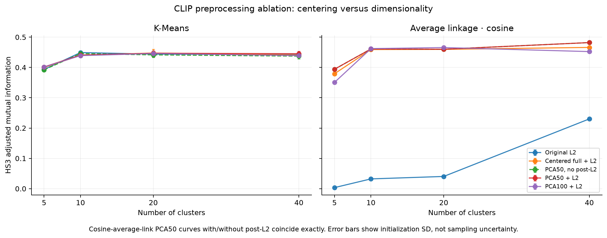
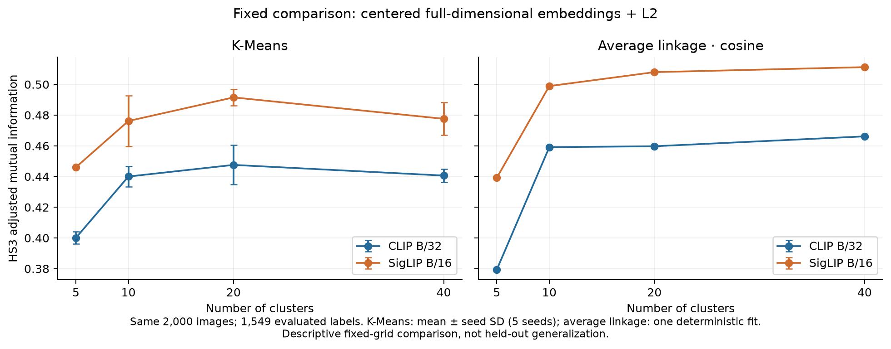

# Next update: Clustering meets Vision and Language

Progress for 2 November 2026. Completed experiments only. Original pilot artifacts remain unchanged.

## Question and design

Do frozen vision-language embeddings group instrument photographs according to the expert Hornbostel–Sachs taxonomy, and which preprocessing choices change that answer? Same 2,000 images / 216 museums; HS3 evaluation uses the same 1,549 labeled rows. All images, including missing-label records, enter clustering.

Five representations: original L2; centered full-dimensional + L2; PCA50; PCA50 + L2; PCA100 + L2. K-Means uses five seeds, ten restarts; average linkage uses cosine distance. Fixed k=5/10/20/40. Two encoders give 240 full-grid fits / 720 score rows. Five paired 80% image subsets at a fixed centered k=10 anchor add 60 fits; 1,600 size-preserving random partitions provide chance controls. In total, all 5,700 AMI/ARI/NMI rows and 480 full-sample silhouette values were independently recomputed from saved predictions. The pilot was already explored in phase 1; declaring this phase’s comparisons does not convert it into a held-out test.

## Main result: centering explains the collapse rescue

For CLIP average linkage at k=5, raw L2 has HS3 AMI **0.0035** and a **99.65%** largest cluster. Centering in all 512 dimensions gives **0.3793** and **37.10%**, without dimensionality reduction. PCA50+L2 gives 0.3942 and 32.40%. At k=10, centered full-dimensional AMI 0.4591 is close to PCA50 0.4610. PCA50 helps at some other cuts, but PCA100 does not improve consistently: there is no general dimensionality-reduction benefit established here.

For cosine average linkage, PCA50 partitions are exactly identical with and without post-L2 at every k, for both encoders. Positive row scaling cannot affect cosine distance. K-Means changes with normalization, but CLIP preprocessing gains are small and inconsistent across k. [Full Task 1 results](TASK1_RESULTS.md).

## CLIP versus SigLIP: matched configurations

SigLIP: `timm/ViT-B-16-SigLIP`, revision `41f575766f40e752fdd1383e9565b7f02388c1c4`, 768 dimensions; CLIP: LAION ViT-B/32, 512 dimensions. Both frozen, CPU float32, four threads. Both receive the original EXIF/RGB white-square-padding policy, then each checkpoint’s published evaluation transform. SigLIP uses 224-pixel bicubic squash and mean/std 0.5. This compares complete encoder/preprocessing bundles, not the pretraining loss alone. [Model manifest](siglip/embedding_manifest.json).

The centered full-dimensional k=10 anchor was declared before the new phase 2 fits, independently of their HS scores:

| Encoder | Method | HS3 AMI (mean ± seed SD) | ARI | NMI | Largest cluster % | Cosine silhouette |
| --- | --- | --- | --- | --- | --- | --- |
| CLIP | kmeans | 0.4400 ± 0.0066 | 0.3063 | 0.4542 | 14.57 | 0.1345 |
| CLIP | average_cosine | 0.4591 | 0.3662 | 0.4729 | 24.35 | 0.1186 |
| SIGLIP | kmeans | 0.4762 ± 0.0166 | 0.3443 | 0.4895 | 13.51 | 0.1575 |
| SIGLIP | average_cosine | 0.4989 | 0.3598 | 0.5111 | 28.25 | 0.1205 |

SigLIP’s paired HS3 AMI is higher in **38/40** declared cells (34/36 after removing cosine’s duplicate normalization condition). Mean grid deltas: K-Means +0.0436; average cosine +0.0323. These equal-weight grid summaries reuse the same images; cells are not independent replicates. At the fixed anchor, deltas are +0.0362 and +0.0398. Average-linkage anchor ARI is slightly lower for SigLIP (0.3598 vs 0.3662), so improvement is not unanimous across metrics. No best method/k was selected and reported as an unbiased estimate.

## Chance and stability

Twenty prediction permutations per seed-0 configuration preserve full cluster sizes. Their AMI is near zero; observed anchor partitions exceed this chance control. Raw NMI has a positive chance baseline; AMI/ARI are adjusted. [Chance results](evaluation/) and [figure](figures/chance_baseline.png).

| Encoder | Method | Mean within-subset initialization SD | SD of subset seed-means |
| --- | --- | --- | --- |
| CLIP | average_cosine | not applicable | 0.0193 |
| CLIP | kmeans | 0.0094 | 0.0091 |
| SIGLIP | average_cosine | not applicable | 0.0039 |
| SIGLIP | kmeans | 0.0116 | 0.0040 |

Each of five subsets contains 1,600 images sampled without labels, with centering refit within that subset; identical subsets are used for both encoders. average_cosine: mean paired delta +0.0320, positive in 4/5 subsets; kmeans: mean paired delta +0.0427, positive in 5/5 subsets. Seed SD measures initialization. Variation across subset means measures conditional composition sensitivity: overlapping subsets of one museum-balanced pilot do not supply an independent-dataset confidence interval. Near duplicates may inflate stability. At the fixed anchor, SigLIP has higher K-Means AMI seed SD despite stronger average partition agreement; score variability and partition stability are different quantities. [Saved subset deltas](paired_subset_deltas.csv).

## Data quality and limitations

- HS3 is missing for 451/2,000 images (22.55%). Aerophones are 52.1% of HS1-labeled images. Seven museums have no HS3 labels; 71 have complete coverage in this small sample. Museum contributions are only 1–14 images. Evaluation may favor better-catalogued instruments and cannot establish cross-museum generalization.
- The 180-image [review gallery](galleries/human_review_180.html) spans 106 museums and all five HS1 classes, with missing/conflicting-label and outlier strata. A [blank annotation template](review/annotation_template.csv) and [codebook](review/ANNOTATION_CODEBOOK.md) are ready. No human annotations, source corrections or exclusions were applied.
- Lexical screening flags 65 possible parts records, with 61.5% missing HS3 versus 21.2% in the rest. These are screening flags, not prevalence estimates: “embouchure” can describe an entire flute. The enriched review sample cannot estimate a collection-wide error rate.
- Visual inspection found a generic placeholder at row 237 (HS3 421), piano branding/detail at row 1834 (HS3 314), and a painting at row 1955 (no HS). 191 near-duplicate/view candidate pairs were flagged; 15 disjoint pairs are shown for confirmation. Exact pixel deduplication alone does not ensure independent objects. [Observations](review/visual_observations.csv).
- Both encoders had image-text supervision before this experiment. Clustering is unsupervised, not necessarily representation pretraining. Internal silhouettes describe geometry, not taxonomy correctness. No held-out population estimate, expert-validated clean benchmark or new-dataset confidence interval is claimed. Wall times are recorded but include concurrent local audit/review activity, so they are not an isolated speed benchmark.

[Meaningful grouping gallery](galleries/meaningful_grouping.html) · [Failure gallery](galleries/failure_case.html) · [Cluster-size imbalance](figures/cluster_size_imbalance.png)

## Next steps

1. Complete human review, confirm object/view groups, and release an explicit curated version. Re-run the fixed grid on it as a declared sensitivity analysis; retain this uncurated result.
2. Acquire a focused cross-museum sample with at least 100 coded images per selected museum. Group near duplicates/specimens before splitting. Fit PCA and K-Means on training museums only, freeze the configuration using separate development data, then score unseen museums. Declare an out-of-sample rule separately for agglomeration.
3. Use museum/specimen-level resampling and external evaluation for population uncertainty. Investigate hierarchical/multilabel HS scoring and crop/padding sensitivity after data-quality controls.

[Protocol and reproduction](PROTOCOL.md) · [Per-run CLIP scores](clip/scores.csv) · [Per-run SigLIP scores](siglip/scores.csv) · [Paired grid](paired_encoder_comparison.csv). No commit or push was performed.

Model source: [SigLIP checkpoint and published configuration](https://huggingface.co/timm/ViT-B-16-SigLIP); converted from the original Google Big Vision checkpoint. All numerical findings above are from this local run.
