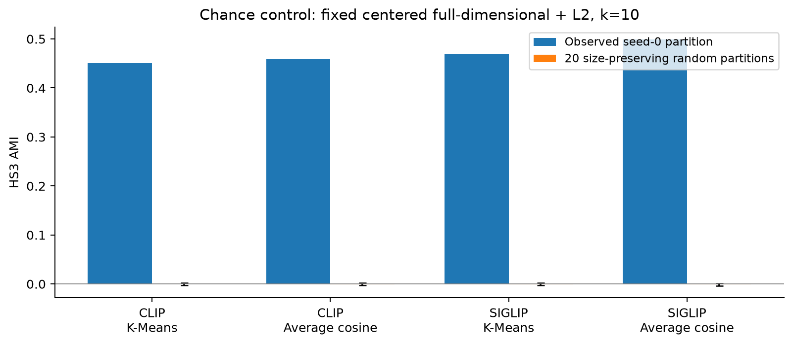
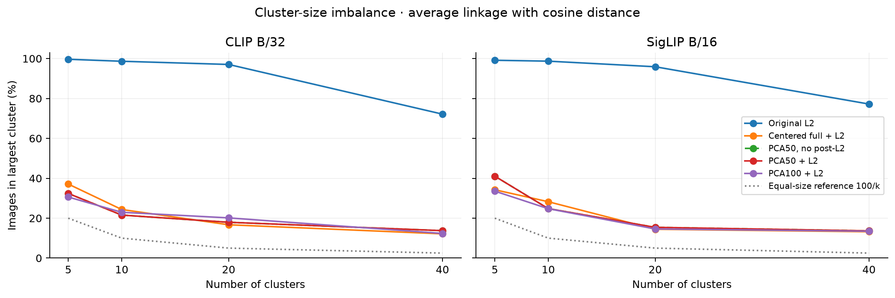

# Clustering meets Vision and Language
## Topic 1 · Progress, 2 November 2026

**Question:** Do clusters of museum-instrument photos recover Hornbostel–Sachs categories?

**Finding:** The geometry’s origin matters more than the first PCA comparison suggested.

---

## 1. Controlled comparison

- Fixed 2,000 MIMO images, 216 museums; HS3 labels for 1,549.
- Frozen CLIP B/32 and SigLIP B/16; identical image order and evaluation masks.
- Five representations; K-Means and cosine average linkage; k=5,10,20,40.
- Five K-Means seeds. 240 full-grid fits; all metrics independently checked.
- Labels are used for scoring, never to fit embeddings, PCA or clusters.

Speaker note: The pilot is museum-balanced and uncurated. These are descriptive results on a fixed dataset, not unseen-museum generalization.

---

## 2. What actually fixes the CLIP failure?

| Average linkage, k=5 | HS3 AMI | Largest cluster |
| --- | --- | --- |
| Raw L2 | 0.0035 | 99.65% |
| Centered full + L2 | 0.3793 | 37.10% |
| PCA50 + L2 | 0.3942 | 32.40% |

- Centering rescues the clustering without reducing dimension.
- PCA50 with/without L2 gives identical cosine partitions; no normalization benefit.
- PCA dimensionality has no consistent monotonic benefit.

---

## 3. A second encoder, compared fairly

- Fixed centered-full + L2, k=10: K-Means AMI 0.440 → 0.476; average linkage 0.459 → 0.499.
- SigLIP improves HS3 AMI in 38/40 matched cells; no claim from a single maximum.
- Average-linkage anchor ARI is slightly lower for SigLIP. Encoder/preprocessing bundles differ; this does not isolate the sigmoid loss.

---

## 4. Chance and variability

- Size-preserving random partitions have AMI near zero.
- Initialization and image composition are different uncertainty sources.
- CLIP K-Means: within-subset seed SD 0.0094; SD across subset means 0.0091.
- Five overlapping 80% subsets are a sensitivity check, not a future-museum confidence interval.
- AMI stability can differ from partition agreement.

---

## 5. The data are a research problem too

- 22.55% lack HS3; class and museum-label coverage are uneven.
- Placeholder with an HS label; piano-brand detail; painting; near-duplicate/view candidates.
- Review set: 180 images / 106 museums; blank annotation CSV; no labels silently repaired.
- The raw-average-link failure has one 1,993-image group and small outlier clusters.

[Review gallery](galleries/human_review_180.html) · [Meaningful grouping](galleries/meaningful_grouping.html) · [Failure case](galleries/failure_case.html)

---

## 6. Next experiments and take-home

1. Expert review and versioned removal of placeholders/parts; specimen-aware duplicate grouping.
2. Focused sample with ≥100 coded images per museum; separate development and held-out museums.
3. Freeze preprocessing/k before held-out scoring; fit PCA on training museums only.
4. Museum/specimen-level uncertainty and hierarchical HS evaluation.

**Take-home:** Centering fixes a major geometric failure. SigLIP improves many matched AMI comparisons on this pilot. Data quality and external validation remain the barriers to a broader claim.

---

## Appendix: illustrative shape grouping

Fixed CLIP raw-L2 K-Means k=5, seed 0; nearest-centroid examples, chosen without label scores.

---

## Appendix: a failure that AMI alone does not explain

Fixed CLIP raw-L2 cosine average linkage k=5. Random examples from the giant cluster plus all small-cluster members.

---

## Reproducibility and references

- Immutable inputs, model revision/weight hashes, saved predictions and masks.
- All 5,700 metric rows and 480 silhouettes independently recomputed.
- Original pilot unchanged; new outputs confined to phase2 and ignored model/photo caches.
- [Detailed results](NEXT_UPDATE.md) · [Protocol](PROTOCOL.md)
- [SigLIP checkpoint](https://huggingface.co/timm/ViT-B-16-SigLIP) · [CLIP checkpoint](https://huggingface.co/laion/CLIP-ViT-B-32-laion2B-s34B-b79K)
